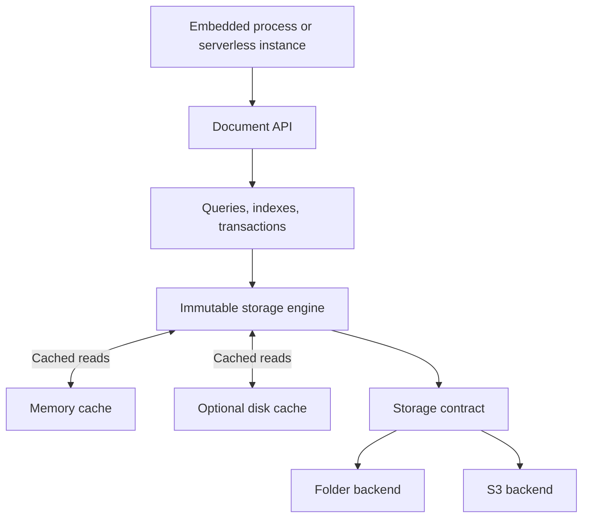

# Obelisk plan

Obelisk is a Rust document database for general application data: users, projects,
settings, and content. It separates compute from durable storage while providing
a document API, hierarchical document paths, and explicit indexes.

This document records the intended architecture. Requirements below are confirmed;
implementation choices and proposed defaults remain adjustable during prototyping.

## Confirmed requirements

- Implement the database in Rust.
- Support a simple local process using a data folder, with a single-file storage
  module possible later.
- Support S3 as authoritative storage, with optional disk and memory caches.
- Allow multiple independent serverless instances to write concurrently from the
  first version. A permanent single-writer process must not be required.
- Put storage implementations behind a common contract.
- Use one shared compute engine across embedded, server, and serverless hosts.
- Address documents by paths such as `a`, `a/b`, and `a/b/doc`. Every path can hold
  a document and have descendant documents; there is no alternating
  collection/document structure.
- Provide limited, predictable, indexed document queries, with room to expand.
- Support the core value types `binary`, `string`, `integer`, `double`, `boolean`,
  and `list<T>`.
- Represent nested fields with paths such as `field.type.etc`. Maps are not a
  first-class value type.
- Permit deliberate duplication of data when it improves useful operations.
- Keep storage, caching, indexing, and maintenance configurable and extensible.
- Defer the network wire protocol until the core engine is established.

## Document and field model

### Document paths

Every document has a canonical, slash-separated path. A document and its
descendants are independently stored records:

```text
projects                         -> document
projects/obelisk                  -> document
projects/obelisk/settings         -> document
projects/obelisk/settings/editor  -> document
```

Proposed behavior:

- A document may exist without any ancestor document existing.
- Reading a document returns its own fields, without loading descendants.
- Deleting a document preserves descendants. Recursive deletion is explicit.
- `children(path)` selects existing documents exactly one segment below `path`.
- `descendants(path)` selects existing documents at any greater depth.
- Neither query includes the document at `path` itself.
- Missing intermediate documents are not synthesized by child queries. Namespace
  browsing can be a separate feature later.
- The root is initially a virtual scope rather than a document.

Logical paths must not be mapped directly onto physical filesystem paths. A file
and directory cannot ordinarily occupy the same path, whereas Obelisk explicitly
allows `a` and `a/b` to both be documents. Storage uses internal object identifiers.

Encode path segments unambiguously so a descendant query under `a/b` cannot match
`a/bc`. Specify normalization, case sensitivity, empty segments, and escaping
before freezing the persistent key format.

### Core value types

The value system is intentionally small:

| Type | Meaning | Proposed initial representation |
| --- | --- | --- |
| `binary` | Arbitrary bytes | Length-prefixed byte sequence |
| `string` | Text | UTF-8 |
| `integer` | Whole number | Signed 64-bit integer |
| `double` | Floating-point number | IEEE 754 binary64 |
| `boolean` | True or false | Boolean |
| `list<T>` | Ordered, homogeneous values | Element type plus length and elements |

Integer width and floating-point edge-case behavior are proposed defaults, not
additional user requirements. Define them before implementing persistent values
or index encodings.

Typed-list rules:

- A list declares its element type, including when it is empty.
- Every element must match that type; heterogeneous lists are invalid.
- Preserve ordering and duplicate elements.
- The proposed recursive type grammar allows `list<list<T>>`; each nested list
  still has the declared element type.
- A list of maps or anonymous object values is outside the initial value model.

No `map`, `object`, `null`, timestamp, or decimal value type is included initially.
An absent field is distinct from any stored value. Field removal is an explicit
mutation, rather than a special null value. Additional types can be introduced
through versioned format extensions.

### Nested fields

A document contains typed values addressed by field paths. Dots separate field
segments in the convenient textual representation:

```text
profile.name           : string       = "Ada"
profile.enabled        : boolean      = true
profile.login_count    : integer      = 42
profile.rating         : double       = 4.5
profile.avatar         : binary       = <bytes>
profile.tags           : list<string> = ["admin", "developer"]
profile.recent_scores  : list<double> = [0.8, 0.9]
```

`profile` groups the fields structurally; it is not a stored map value. An internal
tree or associative data structure may implement the document without exposing a
general-purpose map type to callers.

Document paths and field paths are separate:

```text
Document: projects/obelisk/settings
Field:    editor.font.size
Value:    integer(14)
```

Proposed field-path behavior:

- Provide a structured field-path API in addition to dotted strings, so literal
  dots in field names have an unambiguous representation.
- A field can be patched or removed without replacing unrelated fields.
- Reject simultaneous terminal fields such as `profile` and `profile.name` in
  one document. This proposed rule keeps JSON-like nesting unambiguous; it does
  not restrict ancestor/descendant document paths.
- A missing value is not interchangeable with an empty string, empty list, zero,
  or false.
- Avoid implicit type coercion. Initially, equality and index matching should
  distinguish integer and double values unless an explicit conversion is used.
- Finalize double handling, including NaN, infinity, and signed zero, before
  implementing equality and ordered index keys.

Any future JSON import/export is an adapter. Ordinary JSON cannot preserve binary,
the type of an empty list, or every integer/double distinction without conventions.

## Public API direction

The Rust API should expose document operations rather than SQL. The following is
illustrative API syntax, not an implemented interface:

```rust
db.get("projects/obelisk").await?;

db.put("projects/obelisk", document).await?;

db.patch("projects/obelisk", patch)
    .if_revision(previous_revision)
    .await?;

db.children("projects")
    .filter(eq("metadata.enabled", true))
    .order_by("metadata.name", Asc)
    .limit(50)
    .fetch()
    .await?;

db.descendants("projects")
    .filter(eq("metadata.kind", "task"))
    .fetch()
    .await?;
```

Initial writes should include full replacement, field patches, deletion,
create-if-absent, revision-conditional updates, and atomic batches. Define patch
behavior for missing documents and conflicting field paths explicitly.

Start transactions with deterministic mutations and explicit read conditions.
If transaction callbacks are added, document that retries may invoke them more
than once and that external side effects cannot be made atomic by this database.

## Engine boundaries



Keep clear Rust module boundaries for types and encoding, document operations,
query planning, indexes, transactions, storage, caching, and maintenance. These do
not all need separate crates initially.

Hosts provide configuration, credentials, and execution time. The shared engine
owns query behavior, transaction semantics, and recovery. A separate pluggable
compute abstraction is unnecessary initially.

## Storage contract

The contract includes behavior and durability guarantees, not only method names.

| Operation | Required behavior |
| --- | --- |
| Read immutable object or range | Return complete bytes from the identified object |
| Create immutable object | Atomically create without replacing an existing object |
| Read database head | Return current snapshot reference and opaque version token |
| Conditionally replace head | Publish only if the expected version still matches |
| Delete objects | Reclaim data proven unreachable by the engine |
| List objects | Support maintenance and recovery |

Ordinary queries use database indexes rather than object-store listings. Reads of
the head and conditional replacement must provide the ordering required by the
commit protocol. Newly published heads must only reference objects that are
already durable and readable.

Version tokens are backend-specific. An adapter may use an S3 ETag or a local
generation. Head contents include a unique commit identity; publication must not
reuse old head contents in a way that introduces an ABA problem.

The folder backend must provide process-safe coordination, durable file writes,
and atomic publication. A mutex within one process is insufficient when multiple
processes open the same database.

The S3 backend uses immutable objects plus conditional writes for publication.
S3 provides strong consistency and atomicity for individual keys, but the database
must implement transactions across multiple stored objects.

Evaluate Rust's `object_store` crate for backend transport and operations. Keep
Obelisk's contract explicit, and test each adapter's actual behavior. A backend
that lacks the required conditional-update primitive needs a compatible metadata
coordinator; ordinary unconditional object writes are insufficient.

Use a data folder for the initial local backend. A single-file backend is a later
module requiring its own allocation, recovery, and reclamation implementation.

## Concurrent commits and consistency

### Snapshot publication

Each database has one mutable head pointing to an immutable snapshot manifest:

```text
HEAD
  -> snapshot manifest
       -> document segments
       -> hierarchy and field-index segments
       -> index definitions
       -> transaction/idempotency records
```

The manifest identifies a consistent database snapshot. Use shared metadata pages
or checkpoints so startup does not require replaying the full commit history or
downloading all document data.

The initial commit algorithm is:

1. Read the current head and establish a transaction snapshot.
2. Check whether the request was already committed.
3. Read the documents and conditions needed to evaluate the mutation.
4. Generate document changes and corresponding index additions and removals.
5. Upload immutable segments and the new manifest.
6. Conditionally replace the head using the original version token.
7. Acknowledge success only after durable publication succeeds.

Multiple instances can prepare concurrently. If two transactions start from the
same head, only one can publish against that version. The other reopens the latest
snapshot and retries its transaction, with bounded backoff and retry limits.

On conflict, recompute changes that depend on current data, including index
removals. Attaching stale index changes to a newer manifest is unsafe. Explicit
revision preconditions that no longer hold should return a revision conflict.

Initially retry the entire transaction after a head conflict. Later optimizations
may reuse safe work after validating its dependencies.

### Isolation and scale

All transaction reads come from the starting snapshot. Publication succeeds only
if that snapshot remains current. This is the basis for serializable transactions
within one database, provided every relevant read and condition follows the same
protocol. The initial approach is conservative: unrelated writes can cause retries.

Multiple independent serverless writers are supported, with one serialized
publication point per database. The head is the first expected contention
bottleneck and must be measured early.

Scale first through independent databases or tenant partitions, each with its own
head. Cross-partition atomic transactions are outside the initial scope. Further
sharding of one logical database requires an explicit design for routing, queries,
and transaction boundaries.

Return a commit receipt containing database identity, request identity, document
revisions where applicable, and snapshot/commit identity.

### Idempotency and ambiguous outcomes

A process may publish successfully but lose the response. A timeout therefore
does not necessarily mean that a mutation failed.

Persist request IDs and outcomes atomically with document changes. A retry checks
the record before applying the mutation again. Associate an ID with its operation
payload so accidental reuse for a different operation is rejected.

Define a retention window for request records and the behavior after it expires.
Provide a way to resolve uncertain outcomes within that window. This is especially
important for increments and other non-idempotent mutations.

## Physical storage and maintenance

Start with an LSM-style layout of immutable sorted segments. Writes append new
records; background compaction merges segments and removes obsolete versions when
retention permits.

| Record family | Purpose |
| --- | --- |
| Documents | Typed document values keyed by canonical document path |
| Parent membership | Enumerate immediate child documents efficiently |
| Field indexes | Filter and order by indexed field paths |
| Tombstones | Record document and index-entry deletions |
| Request records | Recognize committed requests and recover outcomes |

Pack many records into each storage object. Use block indexes, checksums,
compression, and Bloom filters where useful. Read relevant blocks with range
requests. Resolve record versions using committed ordering, not independent
compute instances' wall clocks.

The first implementation can persist segments directly for each committed batch.
Introduce a separate write-ahead log only if measurements justify the additional
recovery machinery. Any future log used to acknowledge durable cloud writes must
itself be durable before acknowledgement.

Compaction is necessary to bound read amplification and storage growth. Local
mode can run it inside the process. Serverless mode needs bounded, resumable
maintenance invocations using the same engine. Maintenance cannot depend on work
continuing after an invocation ends.

Publish compaction results through the commit protocol. If concurrent commits
change its inputs, compaction must validate and retry without discarding newer
data. Large maintenance jobs should support backpressure and resumable progress.

## Indexes and queries

Initial query scope:

- Exact-path lookup and bulk lookup.
- Immediate-child and descendant queries.
- Equality filters.
- A range filter with compatible ordering.
- Explicit composite indexes.
- Limits, field projections, and cursor pagination.

Index definitions include query scope, field paths, field order, type behavior,
and optional covered fields. Begin with scalar string, integer, double, and boolean
indexes. Binary indexing and list membership indexes can be added deliberately;
storing binary and lists does not require indexing them in the first release.

Define type tags, missing-field behavior, string ordering, and numeric ordering
before encoding index keys. Type changes must remove old index entries and add
the appropriate new entries in the same transaction.

Document changes and all maintained index changes become visible through the same
snapshot publication. Query plans must not use incomplete indexes. Index creation
and rebuilding need an explicit lifecycle; online builds require a consistent
base snapshot, concurrent-change reconciliation, and atomic activation.

For unsupported indexed queries, return a useful description of the missing index
or unsupported operation. Provide an explicit scan API for deliberate scans.

Pagination cursors include query identity, a pinned snapshot, and a deterministic
document-path tie-breaker. Resuming an expired snapshot returns an explicit error.

Joins, arbitrary expressions, full-text search, general aggregation, and advanced
list predicates are later extensions.

### Deliberate duplication

Duplicate data when it saves a concrete operation:

- Parent membership records avoid discovering immediate children by scanning all
  descendants.
- Field indexes avoid scanning full documents for filters and ordering.
- Covering indexes may include selected projection fields so queries can return
  results without fetching each document.
- Immutable versions allow concurrent snapshot readers and efficient append-based
  updates.

Every maintained copy increases storage and write work. Avoid automatically copying
the full document into every index. Measure the benefit of each index and expose
its maintenance cost.

## Caching and read freshness

| Deployment | Durable authority | Read caches |
| --- | --- | --- |
| Local folder | Database files | Memory |
| S3 with persistent compute | S3 | Memory and optional disk |
| S3 with serverless compute | S3 | Memory and available temporary disk |

Cache immutable blocks using keys such as:

```text
(database_id, object_id, block_offset, format_version)
```

Decoded document caches also need a revision or snapshot identity. Immutable
objects make cache correctness simpler because their contents never change.

The mutable head has separate freshness rules. Proposed read modes:

- `Latest`: obtain a fresh authoritative head, then read consistently from that
  snapshot.
- `Snapshot`: read a particular retained snapshot.
- `Cached`: explicitly permit a configured amount of staleness.

Do not silently reuse an old head for a latest read. A fully cached document does
not by itself prove it is the latest revision.

Consider separate budgets for data and index metadata, deduplication of concurrent
cache misses, and scan-aware admission so a large scan does not evict hot point-read
data. Caches should be removable without losing acknowledged durable writes.

Serverless temporary disk is an opportunistic cache. It may survive warm reuse,
but is neither durable nor inherently shared across instances. Cold starts must
remain correct without any cached state.

## Recovery, retention, and backup

- Uploads that never become reachable from a committed manifest are orphaned data.
- Acknowledged writes must survive losing every compute instance and cache.
- Recovery opens committed state rather than trusting partially written local
  files or unpublished objects.
- Garbage collection protects retained snapshots, active readers, and in-flight
  commits. Age alone is not sufficient proof that an object can be deleted.
- Define a reader/snapshot retention protocol, including expiration and renewal,
  before enabling reclamation.
- Backups pin a manifest and retain or copy all objects reachable from it.
- Restores validate format compatibility and publish restored state through an
  explicit procedure.
- Version persistent value, key, segment, manifest, and index formats from the
  first release. Specify migration and compatibility behavior.

## Extensibility and tuning

Start with Rust traits and compile-time features for storage adapters, cache
implementations, codecs, and compaction policies. Dynamic runtime plugins are a
later option. The engine retains ownership of transaction and index invariants.

Expose tuning for:

- Memory and disk cache budgets.
- Block and segment sizes.
- Compression and cache admission.
- Write batching and I/O concurrency.
- Retry budgets and contention backoff.
- Compaction concurrency and work budgets.
- Snapshot, backup, and idempotency retention.
- Document, field, list, batch, and query resource limits.

Offer practical local, cloud-interactive, and bulk-ingestion profiles. Measure
latency, object-store requests and bytes, cache hits, retry conflicts, read/write
amplification, and maintenance backlog so tuning has observable effects.

## Delivery sequence

1. **Commit protocol prototype:** folder and S3 adapters, immutable objects,
   conditional publication, concurrent writers, idempotency, and crash recovery.
2. **Document engine:** core typed values, typed lists, nested field paths,
   document paths, CRUD, revisions, atomic batches, and snapshot reads.
3. **Query engine:** hierarchy and field indexes, transactional index maintenance,
   pagination, compaction, and caching.
4. **Operational layer:** resumable maintenance, garbage collection, backup and
   restore, metrics, tuning profiles, and deployment examples.
5. **Transport:** wire protocol and clients over the established engine semantics.

## Validation and early measurements

The first prototype must run multiple real processes against both the local
backend and S3. Exercise conflicting and disjoint mutations, process termination
during every commit stage, dropped success responses, and retries using the same
request identity.

Verify acknowledged writes and index consistency after restart. Test that queries
never observe document changes without their corresponding index changes. Test
typed-value round trips, homogeneous-list enforcement, typed empty lists, field
path encoding, and segment-boundary correctness.

Measure cold and warm reads, durable-write latency, S3 requests per operation,
conflict retry rates, tail latency, compaction cost, and startup work. Establish
the practical capacity of one database head before assuming a scaling target.

Later reclamation tests must include paused readers and writers, expired snapshots,
concurrent compaction, and orphan cleanup. Backups must be tested by restoring them.

## References and dependency evaluation

- [Amazon S3 consistency model](https://docs.aws.amazon.com/AmazonS3/latest/userguide/Welcome.html)
  describes strong consistency and single-key atomicity.
- [Amazon S3 conditional writes](https://docs.aws.amazon.com/AmazonS3/latest/userguide/conditional-writes.html)
  documents the publication primitives.
- [Rust object_store](https://docs.rs/object_store/latest/object_store/) is a
  candidate dependency for storage operations and transport.
- [Lambda temporary storage](https://docs.aws.amazon.com/lambda/latest/dg/configuration-ephemeral-storage.html)
  describes the lifecycle and per-environment nature of temporary disk.
- [SlateDB introduction](https://slatedb.io/docs/get-started/introduction/) and
  [design overview](https://slatedb.io/docs/design/overview/) are useful references
  for object-storage persistence and caching. Its documented single-writer model
  differs from Obelisk's requirement for independent concurrent serverless writers;
  dependency evaluation must account for that distinction.

## Query foundations delivery block

The query-foundations block replaces whole-manifest metadata maps with bounded
immutable ordered pages, integrates lazy snapshots and transactional publication,
and exposes bulk reads and snapshot-paginated hierarchy discovery. Parent
membership is maintained from the first paged-format write. Its local qualification
and measured limits are recorded in IMPLEMENTATION.md and BASELINE.md. Scalar
field indexes follow in a separate block; actual AWS S3 qualification remains a
parallel external acceptance gate.

Deliver four independently merged cycles: metadata primitives; paged engine
integration; bulk/hierarchy APIs; pagination/concurrency/crash and scaling
qualification. Nothing in this block enables reclamation, compaction, portable
cursor decoding, or a wire protocol.

## Scalar index delivery block

The scalar-index block adds explicit, typed index definitions and order-preserving
composite keys before integrating any index with the authoritative root. It then
adds a resumable online lifecycle, atomic transaction maintenance and bounded
indexed queries, followed by independent-process, interruption and scaling
qualification. A query may use only an active index published in its snapshot.

Cycle 15 delivered definition/key/page primitives. Continue with independently
merged milestones 16A (additive lifecycle/value codecs), 16B (root-integrated build,
reconciliation, activation and mandatory writer maintenance), 17 (indexed query
APIs), and 18 (concurrency/crash and scaling qualification). Activation cannot
precede writer maintenance, even before public indexed queries are exposed. The block
starts with exact string, integer, double and boolean components. Binary and list
indexes, deliberate scans, compaction, reclamation, portable cursor tokens and a
wire protocol remain outside it.

The approved v3 integration uses a paged catalog of bounded lifecycle descriptors,
one scalar-entry tree per generation and separate immutable covered projections.
An online candidate enumerates a pinned source snapshot while foreground writers
maintain both candidate and active generations. Each chunk reads current documents
and publishes entries plus its last examined source path through HEAD CAS. At
source exhaustion, all processed source paths and paths mutated since registration
cover the current eligible documents; activation is one atomic publication.
Conflicts recompute from current state. Rebuilds keep the old active generation
available, and dropping removes current visibility without reclaiming history.

Start with 16 live definitions and one candidate build per database. Build calls
default to 100 examined documents, at most 256, and 16 MiB source-payload bytes;
existing aggregate resource budgets also apply. Queries require an exact typed
scope/index shape: equality prefix, an optional range on the next component and
matching remaining ordering. Incomplete indexes and implicit document scans are
never query plans. Native cursors pin the snapshot and generation. Authoritative
v3 databases will use fresh folders/prefixes with explicit rejection of v2, not
automatic migration. The additive 16A codecs kept the v2 writer; 16B selects v3 and integrates
both building and active maintenance before cycle 17 exposes indexed queries.


Cycle 17 exposes exact-shape indexed queries through the facade and pinned
snapshots, including typed prefix/range bounds, declared order, projections,
covered reads and native snapshot cursors. Missing/incomplete indexes fail usefully
instead of triggering implicit scans. Cycle 18 remains the independent-process,
interruption, capacity and release-scaling qualification gate for the complete
scalar block. Actual-AWS acceptance remains externally configured and open.
